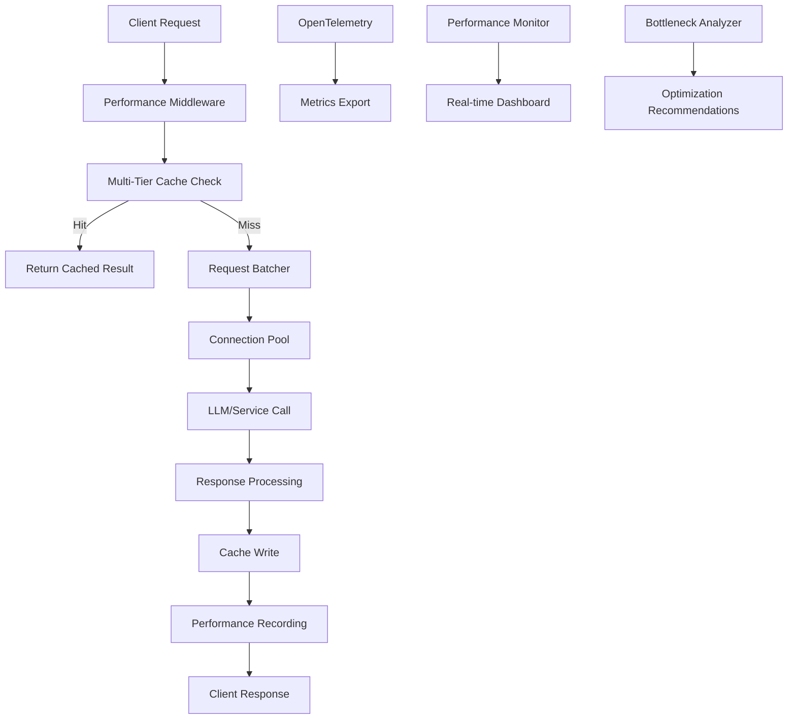

# APISage Performance Optimization Framework

## Overview

This comprehensive performance optimization framework provides detailed timing instrumentation, intelligent caching, request batching, and real-time monitoring for APISage. It addresses latency bottlenecks across the entire API lifecycle and provides actionable insights for optimization.

## 🚀 Key Features

### 1. Enhanced Performance Monitoring
- **OpenTelemetry Integration**: Distributed tracing with automatic instrumentation
- **Step-by-Step Timing**: Detailed timing for each processing step
- **Real-time Metrics**: Live performance dashboards with bottleneck analysis
- **Comprehensive Profiling**: Request-level performance profiles with waterfall visualization

### 2. Multi-Tier Caching System
- **L1 Cache**: Hot data in memory (uncompressed, 100 entries)
- **L2 Cache**: Warm data compressed with LZ4 (1000 entries)
- **Semantic Cache**: Similarity-based retrieval for related queries (500 entries)
- **Adaptive Replacement**: LRU/LFU hybrid eviction policies

### 3. Intelligent Request Batching
- **Automatic Batching**: Groups similar requests to reduce API calls
- **Priority Queues**: High-priority requests processed first
- **Timeout Management**: Configurable batch timeouts (default 100ms)

### 4. Connection Pooling
- **Resource Management**: Efficient connection reuse
- **Health Monitoring**: Automatic connection validation
- **Configurable Limits**: Min/max connection pools per service

## 📊 Architecture



## 🛠️ Implementation Guide

### 1. Installation

Add required dependencies to `pyproject.toml`:

```toml
# Performance Monitoring
opentelemetry-api = "^1.21.0"
opentelemetry-sdk = "^1.21.0"
opentelemetry-instrumentation-fastapi = "^0.43b0"
opentelemetry-instrumentation-httpx = "^0.43b0"
opentelemetry-exporter-otlp = "^1.21.0"
lz4 = "^4.3.2"
scikit-learn = "^1.3.2"
```

Install dependencies:
```bash
poetry install
```

### 2. Basic Usage

#### Starting the Optimized API Server

```bash
# Start the optimized API (includes all performance enhancements)
poetry run python api/main_optimized.py

# Start the performance dashboard
poetry run python performance_dashboard.py
```

#### Using Performance Monitoring

```python
from infrastructure.enhanced_performance_monitor import EnhancedPerformanceMonitor

# Initialize monitor
monitor = EnhancedPerformanceMonitor(
    service_name="my-service",
    enable_tracing=True,
    enable_metrics=True
)

# Profile a complete request
with monitor.profile_request("req-123", "/analyze", "POST") as profile:

    # Time individual steps
    with monitor.time_step("req-123", "cache_lookup"):
        result = cache.get(key)

    with monitor.time_step("req-123", "llm_call", model="gpt-4"):
        response = await llm.generate(prompt)

    # Analyze bottlenecks
    bottlenecks = profile.analyze_bottlenecks(threshold_ms=100)
```

#### Using Multi-Tier Cache

```python
from infrastructure.latency_optimizer import MultiTierCache

# Initialize cache
cache = MultiTierCache(
    l1_size=100,          # Hot data
    l2_size=1000,         # Compressed data
    semantic_cache_size=500,
    ttl_seconds=3600
)

# Store and retrieve
cache.put("key", data, ttl=1800)
result = cache.get("key", semantic_similarity=0.8)

# Get statistics
stats = cache.get_stats()
print(f"Hit rate: {stats['hit_rate']:.1%}")
```

#### Using Request Batching

```python
from infrastructure.latency_optimizer import RequestBatcher

# Initialize batcher
batcher = RequestBatcher(
    batch_size=10,
    batch_timeout_ms=100,
    max_queue_size=1000
)

# Register batch processor
async def process_embeddings(batch_texts):
    # Process all texts together
    return await embedding_service.embed_batch(batch_texts)

batcher.register_processor("embeddings", process_embeddings)

# Use batching
result = await batcher.add_request("embeddings", "text to embed")
```

### 3. Decorator Usage

#### Automatic Caching

```python
from infrastructure.latency_optimizer import cached

@cached(ttl=300)
async def expensive_analysis(api_spec):
    # This function's results will be cached for 5 minutes
    return await analyze_specification(api_spec)

# Usage - first call hits the function, subsequent calls use cache
result1 = await expensive_analysis(spec)  # Function executed
result2 = await expensive_analysis(spec)  # Cache hit
```

#### Automatic Batching

```python
from infrastructure.latency_optimizer import batched

@batched(batch_size=5, timeout_ms=50)
async def batch_embeddings(texts):
    # Automatically batches similar requests
    return await embedding_service.embed_many(texts)

# These calls will be automatically batched
results = await asyncio.gather(
    batch_embeddings(["text 1"]),
    batch_embeddings(["text 2"]),
    batch_embeddings(["text 3"])
)
```

#### Automatic Timing

```python
from infrastructure.enhanced_performance_monitor import time_function

@time_function("llm_analysis")
async def analyze_with_llm(request_id, spec, monitor=None):
    # This function will be automatically timed
    return await llm_manager.generate(prompt)

# Usage
result = await analyze_with_llm("req-123", spec, monitor=global_monitor)
```

## 📈 Performance Dashboard

### Starting the Dashboard

```bash
poetry run python performance_dashboard.py
```

Access at: http://localhost:7861

### Dashboard Features

1. **Real-time Performance Metrics**
   - Request count and response times
   - Error rates with alerting
   - Active request monitoring

2. **Cache Performance Analysis**
   - Hit rates by cache tier
   - Cache size trends
   - Compression statistics

3. **Bottleneck Analysis**
   - Top bottlenecks by frequency and duration
   - Timeline visualization
   - Performance impact analysis

4. **Optimization Recommendations**
   - Automatic bottleneck detection
   - Specific optimization suggestions
   - Performance trend analysis

## 🔧 Configuration Options

### Performance Monitor Configuration

```python
monitor = EnhancedPerformanceMonitor(
    service_name="apisage",
    otlp_endpoint="http://jaeger:14268/api/traces",  # Optional OTLP endpoint
    enable_tracing=True,
    enable_metrics=True,
    enable_profiling=True
)
```

### Cache Configuration

```python
cache = MultiTierCache(
    l1_size=200,              # L1 cache size (hot data)
    l2_size=2000,             # L2 cache size (compressed)
    semantic_cache_size=1000,  # Semantic similarity cache
    compression_threshold=2048, # Compress items larger than 2KB
    ttl_seconds=3600           # Default TTL (1 hour)
)
```

### Batcher Configuration

```python
batcher = RequestBatcher(
    batch_size=20,           # Max items per batch
    batch_timeout_ms=50,     # Max wait time for batch
    max_queue_size=2000      # Max items in queue
)
```

## 🚨 Performance Thresholds & Alerts

### Default Thresholds

```python
thresholds = {
    "total_request_ms": 5000,    # Total request time
    "llm_call_ms": 3000,         # LLM API call time
    "db_query_ms": 100,          # Database query time
    "cache_lookup_ms": 10,       # Cache lookup time
    "embedding_ms": 500,         # Embedding generation
    "context_assembly_ms": 200   # Context assembly time
}
```

### Setting Up Alerts

```python
def handle_alert(alert):
    if alert.level == "CRITICAL":
        send_slack_notification(alert.message)
    elif alert.level == "WARNING":
        log_warning(alert.message)

monitor.add_alert_callback(handle_alert)
```

## 📊 API Endpoints

### Performance Endpoints

- `GET /health` - Health check with performance metrics
- `GET /metrics` - Detailed performance metrics
- `GET /performance/profile/{request_id}` - Request performance profile
- `POST /performance/clear` - Clear performance data

### Optimized Endpoints

- `POST /analyze-optimized` - Optimized API analysis with caching
- `POST /rag-query-optimized` - Optimized RAG with semantic caching
- `POST /batch-analyze` - Batch analysis endpoint

## 🧪 Testing Performance Improvements

### Load Testing Script

```python
import asyncio
import time
import httpx

async def load_test():
    async with httpx.AsyncClient() as client:

        # Test without optimization
        start = time.time()
        tasks = []
        for i in range(50):
            task = client.post("http://localhost:8080/analyze", json={
                "openapi_spec": test_spec,
                "analysis_depth": "comprehensive"
            })
            tasks.append(task)

        results = await asyncio.gather(*tasks)
        without_optimization = time.time() - start

        # Test with optimization
        start = time.time()
        tasks = []
        for i in range(50):
            task = client.post("http://localhost:8080/analyze-optimized", json={
                "openapi_spec": test_spec,
                "analysis_depth": "comprehensive",
                "enable_caching": True
            })
            tasks.append(task)

        results = await asyncio.gather(*tasks)
        with_optimization = time.time() - start

        improvement = (without_optimization - with_optimization) / without_optimization
        print(f"Performance improvement: {improvement:.1%}")

# Run test
asyncio.run(load_test())
```

## 🔍 Common Performance Issues & Solutions

### Issue 1: High LLM Latency

**Symptoms**: LLM calls taking >3 seconds
**Solutions**:
- Enable request batching for similar queries
- Use semantic caching with similarity threshold 0.8
- Switch to faster models for simple queries
- Implement prompt optimization

```python
# Solution implementation
@cached(ttl=1800, key_func=lambda spec, depth: f"{depth}_{hash(str(spec))}")
@batched(batch_size=10, timeout_ms=100)
async def optimized_llm_call(spec, depth):
    return await llm_manager.generate(create_prompt(spec, depth))
```

### Issue 2: Cache Misses

**Symptoms**: Low cache hit rate (<30%)
**Solutions**:
- Implement semantic caching
- Increase cache sizes
- Use better cache key strategies
- Enable cache warming

```python
# Better cache key strategy
def create_semantic_key(spec):
    # Extract key features for better matching
    features = {
        "endpoints": len(spec.get("paths", {})),
        "has_auth": bool(spec.get("security")),
        "version": spec.get("info", {}).get("version"),
        "title_hash": hash(spec.get("info", {}).get("title", ""))
    }
    return json.dumps(features, sort_keys=True)
```

### Issue 3: Memory Usage

**Symptoms**: High memory consumption
**Solutions**:
- Enable L2 cache compression
- Reduce cache sizes
- Implement cache eviction policies
- Monitor cache statistics

```python
# Memory-efficient cache configuration
cache = MultiTierCache(
    l1_size=50,               # Smaller L1 cache
    l2_size=500,              # Smaller L2 cache
    compression_threshold=512, # Compress smaller items
    ttl_seconds=1800          # Shorter TTL
)
```

## 📋 Monitoring Best Practices

### 1. Set Up Comprehensive Monitoring

```python
# Enable all monitoring features
monitor = EnhancedPerformanceMonitor(
    enable_tracing=True,
    enable_metrics=True,
    enable_profiling=True
)

# Add custom metrics
monitor.record_business_metric("api_specs_analyzed", 1)
monitor.record_business_metric("user_satisfaction", 4.5)
```

### 2. Regular Performance Reviews

- Review performance dashboard weekly
- Analyze bottleneck trends monthly
- Update optimization strategies quarterly
- Benchmark against performance goals

### 3. Automated Alerting

```python
# Set up alerts for key metrics
alerts = {
    "response_time_ms": 2000,    # Alert if >2s
    "error_rate": 0.02,          # Alert if >2%
    "cache_hit_rate": 0.5,       # Alert if <50%
    "queue_size": 100            # Alert if queue >100
}

monitor = EnhancedPerformanceMonitor(
    alert_thresholds=alerts,
    enable_real_time_alerts=True
)
```

## 🔮 Advanced Optimizations

### 1. Predictive Caching

```python
# Implement predictive caching based on usage patterns
class PredictiveCache:
    def predict_next_queries(self, current_query):
        # ML-based prediction of likely next queries
        pass

    def warm_cache(self, predicted_queries):
        # Pre-compute results for predicted queries
        pass
```

### 2. Adaptive Batching

```python
# Adjust batch sizes based on system load
class AdaptiveBatcher:
    def adjust_batch_size(self, current_load):
        if current_load > 0.8:
            return self.batch_size * 2  # Larger batches under high load
        elif current_load < 0.3:
            return max(1, self.batch_size // 2)  # Smaller batches under low load
        return self.batch_size
```

### 3. Geographic Distribution

```python
# Implement geographic caching
class GeographicCache:
    def __init__(self):
        self.regional_caches = {
            "us-east": MultiTierCache(),
            "eu-west": MultiTierCache(),
            "asia-pacific": MultiTierCache()
        }

    def get_regional_cache(self, request_region):
        return self.regional_caches.get(request_region, self.regional_caches["us-east"])
```

## 📚 Additional Resources

- [OpenTelemetry Python Documentation](https://opentelemetry.io/docs/python/)
- [FastAPI Performance Best Practices](https://fastapi.tiangolo.com/advanced/)
- [Redis Caching Strategies](https://redis.io/docs/manual/keyspace/)
- [APM Best Practices Guide](https://newrelic.com/blog/best-practices/apm-best-practices)

## 🤝 Contributing

To contribute performance optimizations:

1. Fork the repository
2. Create a feature branch
3. Add performance tests
4. Ensure monitoring compatibility
5. Submit a pull request with performance benchmarks

## 📞 Support

For performance optimization questions:
- Open an issue with performance profile data
- Include bottleneck analysis from the dashboard
- Provide system specifications and load characteristics

---

*This framework provides comprehensive performance optimization for APISage. Monitor regularly, optimize continuously, and scale efficiently.*